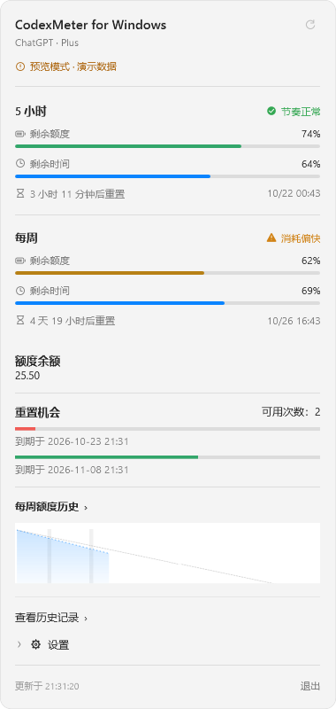
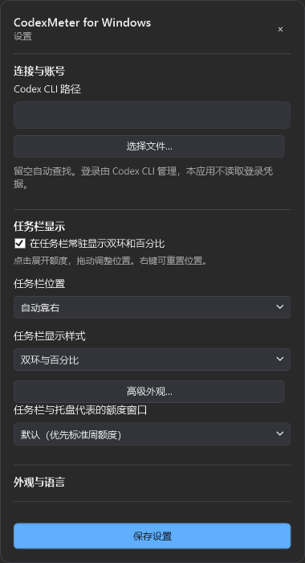

# CodexMeter for Windows

**Keep Codex quota, reset times, and usage trends on your Windows taskbar.**

[简体中文](README.md) · [English](README.en.md)

CodexMeter for Windows monitors Codex quota on **Windows 11 x64**. Taskbar rings and percentages show your remaining quota and time. Click to open detailed quota information, historical charts, and Token activity to help you plan your usage.

An independent Windows implementation inspired by [raycalrui/CodexMeter](https://github.com/raycalrui/CodexMeter). Simplified Chinese is the default; Traditional Chinese and English are also available in Settings.

## Preview

  
  

*Screenshots use demonstration data. Available metrics depend on your Codex account and service responses.*

## Features

| Feature | What you can do |
| --- | --- |
| **Persistent taskbar indicator** | See remaining quota and time with rings and percentages; click for details, dock near Start, or drag to reposition. |
| **Multiple quota windows** | View service-provided five-hour, weekly, and other windows, with reset countdowns, exact reset times, and pacing indicators. |
| **Quota history and trends** | Browse cycles, calendar weeks, and months; inspect observed consumption and conditional exhaustion estimates when sufficient data is available. |
| **Token activity** | View cumulative usage, daily activity, peak days, and streaks, with independent ranges and longer-term summaries. |
| **Appearance and content** | Choose rings, horizontal bars, stacked bars, percentages, or progress bars; customize size, color, typography, and panel sections. |
| **Local and remote reminders** | Configure low-quota and pacing notifications; optionally receive replenishment reminders through Bark, Gotify, Telegram, or Discord. |
| **History management** | Keep account histories separate, choose retention periods, export CSV, and back up, restore, or delete records. |
| **Everyday controls** | Use the system tray, login startup, light/dark themes, and Simplified Chinese, Traditional Chinese, or English. |

Settings hides its vertical scrollbars while retaining wheel and keyboard scrolling. Ordering lists pass scrolling to the page when their content fits or reaches a boundary; longer lists retain internal scrolling.

Advanced appearance shares the compact Settings layout, with a hidden scrollbar, a fixed live preview and fixed footer actions. Controls are grouped by graphics, text and color, with Chinese and English support.

Settings and management windows use muted surfaces, rounded fields and lists, soft selection colors, and clear primary actions in both themes. Ordering lists fit their content to reduce empty space.

Functional windows display the full project name. The details panel is measured and positioned for its target screen before opening, and follows changes to the taskbar indicator's position.

Credits, reset opportunities, and Token activity depend on account and API availability. Missing data is unavailable or omitted rather than displayed as zero. Remote reminders require explicit configuration and opt-in.

## Download and get started

Open **[the latest release](https://github.com/bsxucome/CodexMeter-for-Windows/releases/latest)** and choose a portable package:

| Package suffix | Requirements |
| --- | --- |
| `dotnet10-x64.zip` | **Recommended**: includes the .NET runtime; no separate .NET installation needed. |
| `framework-x64.zip` | Smaller download; requires .NET Framework 4.8 or later. |

1. Install the native Windows Codex CLI and sign in using `codex login`.
2. Extract the entire portable archive and launch `CodexMeter.exe`.
3. Click the taskbar indicator for details. If the CLI is not detected, select its path in Settings.
4. Choose your quota window, indicator style, language, and reminder preferences.

Each archive has a SHA-256 companion file. To upgrade, exit the old version and extract the new package into a separate folder. Preferences and history remain in the current user's local application data directory.

The [usage and build guide](windows/README.md) contains detailed configuration and source build instructions in Chinese.

## Data and privacy

- Reads account and quota information through the local Codex App Server; Codex CLI manages sign-in.
- Does not read authentication files, save emails/passwords/access tokens, or send telemetry.
- Stores history locally with salted account identifiers; recording can be paused and records exported, backed up, or deleted.
- Sends remote reminders only when enabled. Channel credentials are encrypted with the current Windows user's DPAPI.

## Scope

The current target is **Windows 11 x64 with a horizontal primary taskbar**. The indicator is an independent transparent overlay. Mixed-DPI multi-monitor setups, auto-hide, and some shell interactions still require further desktop validation. ARM64 and WSL CLI are not supported.

A configurable updater is implemented, but no production feed or trusted public key is configured. Download updates manually from Releases for now. Portable packages are not code-signed. See the [feature comparison](windows/PARITY.md) and [desktop acceptance checklist](windows/ACCEPTANCE.md) for details in Chinese.

## Documentation and feedback

- [Usage and build guide](windows/README.md) · [Release maintenance guide](windows/RELEASES.md) — Chinese.
- [Report an issue or request a feature](https://github.com/bsxucome/CodexMeter-for-Windows/issues/new/choose) — Chinese and English welcome.
- [Contributing](CONTRIBUTING.md) · [Verification](windows/VERIFICATION.md) · [Upstream provenance](UPSTREAM.md).

## License and credits

Released under the [MIT license](LICENSE), preserving the original copyright notice. Thanks to [raycalrui/CodexMeter](https://github.com/raycalrui/CodexMeter) for the original open-source project. This independent community implementation is not an official OpenAI product. See [UPSTREAM.md](UPSTREAM.md) for provenance and scope.
